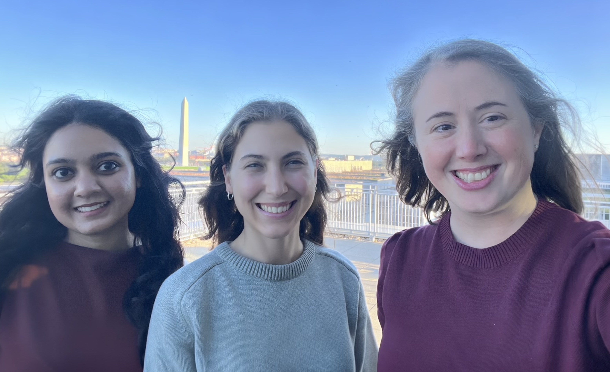

# Sustainability, Systems, and Environmental Ethics

The FEWsLab investigates interconnections across **food**, **energy**, and **water** systems. Our research integrates **network modeling**, **socio-technical data**, and **ethical analysis** to advance both policy and research questions in the areas of risk, resilience, and sustainability. We strive to bridge the gap between advancements in theory and useful insights for decision makers that address pressing global challenges.

---

# Who We Are

The FEWsLab is led by **Dr. Caitlin Grady**, Associate Professor of Engineering Management and Systems Engineering at George Washington University and Director of Research at the [Global Food Institute](https://globalfoodinstitute.gwu.edu/). Dr. Grady brings a combination of academic, policy, and government experience. She has previously served as a faculty member at Penn State, a Policy Analyst at the U.S. Department of State and the Department of Energy, and as a Legislative Assistant in the U.S. Congress. Our lab thrives thanks to a talented and unique team of researchers, students, and collaborators who share a commitment to thinking outside the box.

---

# Research

Our research is supported by the **National Science Foundation**, the **U.S. Department of Agriculture**, the **McGovern Foundation** and other institutional partners. We pursue interdisciplinary projects that address complex challenges through systems thinking, data-driven modeling, and policy-relevant analysis.

<figure style="text-align: center; margin: 1.5rem auto;">
  
  <figcaption style="text-align: center; font-style: italic; margin-top: 0.5rem;">No better place to do engineering + policy work than DC!</figcaption>
</figure>

---

# News and Highlights

- Sachi Nandurkar and Dr. Grady co-authored an article for [The Conversation](https://theconversation.com/formula-1-racing-shows-the-hard-part-of-reaching-net-zero-carbon-emissions-isnt-the-engineering-281495) on why engineering isn't the hard part of Formula One's net-zero goal. 
- Dr. Grady and Abbey Kollar were contributing authors for Virginia’s first energy [infrastructure report card](https://infrastructurereportcard.org/state-item/virginia/).
- Sachi Nandurkar published her [paper](https://doi.org/10.3389/fclim.2026.1854735) and [dashboard]( http://formula-one-netzero.fewslab.org/) analyzing Formula One Net Zero Goals. 
- Dr. Grady was recently named the next Director of Research for the [Global Food Institute](https://globalfoodinstitute.gwu.edu/)
- Abbey Kollar and Ji Qi presented recent research at the 10th International Engineering Systems Symposium hosted by [CESUN](https://cesun.org/)
- Dr. Grady was quoted in a recent episode of NPR's All Things Considered [July 4, 2025](https://www.npr.org/2025/07/04/nx-s1-5454884/why-hydropower-faces-more-barriers-than-wind-or-solar)
- Dhanyasri Bolla was invited to present our work on Adaptation in Megacities to the IDB Annual Meeting of the Chief Audit Executives of the Multilateral Financial Institutions

