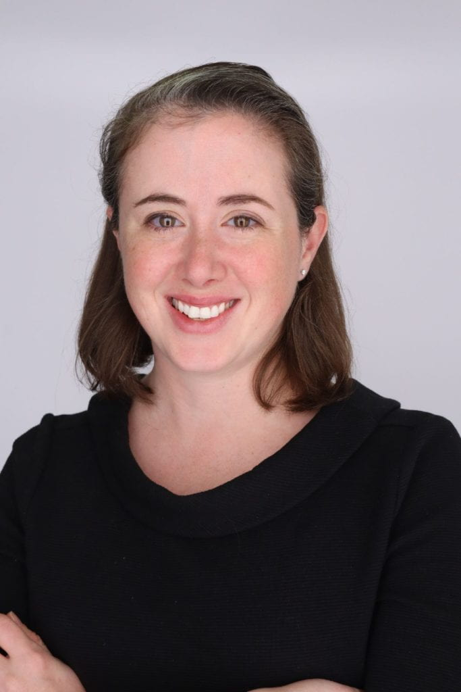

```{=html}
<div class="fd" id="research-for-decisions">

<!-- HERO -->
<header class="fd-hero fd-dark">
  <div class="fd-hero-inner">
    <p class="fd-hero-org">FEWsLab, George Washington University</p>
    <h1 class="fd-hero-title">Evidence for decisions that have a date.</h1>
    <p class="fd-hero-lede">FEWsLab builds models and data for people making big decisions without all the information they'd like. Our work has covered ocean treaties, corporate climate targets, humanitarian aid, and where data centers can safely be built, among other things. What we care about most is showing which unknowns matter.</p>
  </div>
  <ol class="fd-dates" aria-label="Decisions this work is built around">
    <li>
      <span class="fd-date">January 2027</span>
      <span class="fd-date-what">First Conference of the Parties to the High Seas Treaty, UN Headquarters, New York</span>
    </li>
    <li>
      <span class="fd-date">2027</span>
      <span class="fd-date-what">Global rules for shipping emissions at the International Maritime Organization</span>
    </li>
    <li>
      <span class="fd-date">2030</span>
      <span class="fd-date-what">Formula 1's net zero target, a test case for corporate climate commitments</span>
    </li>
  </ol>
  <p class="fd-scrollcue">Scroll to read</p>
</header>

<!-- 1. TWO CLOCKS -->
<section class="fd-section fd-light" aria-labelledby="clocks-h">
  <div class="fd-intro">
    <h2 id="clocks-h">The decision clock and the research clock rarely line up.</h2>
  </div>
  <div class="fd-scrolly" data-graphic="clocks">
    <figure class="fd-graphic" aria-label="Illustrative timeline comparing a conventional research grant path with a standing research team, relative to a fixed decision date.">
      <div class="fd-svg"></div>
      <figcaption>Illustrative timeline, in months.</figcaption>
    </figure>
    <div class="fd-steps">
      <div class="fd-step" data-step="0"><p>A negotiation runs on a fixed calendar. Delegations set their positions weeks before a session opens. Once a text is adopted, it holds for years.</p></div>
      <div class="fd-step" data-step="1"><p>Research funding runs on a different calendar. A question becomes a proposal. The proposal waits for review. Findings reach a journal long after the question was urgent. In this sketch, the evidence arrives after the decision is made.</p></div>
      <div class="fd-step" data-step="2"><p>A standing team changes the timing. Researchers who already follow a process can answer a new question in weeks, because the data, models, and relationships are in place.</p></div>
      <div class="fd-step" data-step="3"><p>Analysis then reaches negotiators, companies, and agencies before they commit. Standing capacity is what FEWsLab is building. It is also the part of research that project grants rarely pay for.</p></div>
    </div>
  </div>
</section>

<!-- BRIDGE -->
<section class="fd-section fd-paper fd-prose" id="imperfect-data" aria-labelledby="bridge-h">
  <div class="fd-col">
    <h2 id="bridge-h">Working with imperfect data</h2>
    <p>This line of work grew out of Dr. Grady's time at the U.S. Department of State, where she worked on the Montreal Protocol. That included the negotiations over the Kigali Amendment, which phases down HFCs, a group of potent greenhouse gases used in cooling, and the Multilateral Fund, which helps developing countries meet their commitments under the treaty. Her job was to bring analysis to negotiators while talks were still going and positions could still change. The data was rarely complete, and the negotiating calendar didn't wait for it. That experience shapes how the lab works today.</p>
    <p>The people we work with are usually in a similar spot. They are committing to something large, in a system they can only partly see, with data that's patchy or out of date. So we rarely hand anyone a single number. We build models that let people change the assumptions they're unsure about and see what happens. Some assumptions hardly move the result. Others move it a lot, and those are the ones worth discussing.</p>
    <p>The three projects below are examples. They cover very different ground, and they aren't the only things we work on.</p>
  </div>
</section>

<!-- 2. OCEANS -->
<section class="fd-section fd-dark" id="ocean-governance" aria-labelledby="ocean-h">
  <div class="fd-intro">
    <p class="fd-kicker">An example from ocean governance</p>
    <h2 id="ocean-h">Governing the high seas and the ships that cross them</h2>
    <p class="fd-lede">When governments sign onto a treaty or a regulation, they usually live with it for decades. Two negotiations are shaping the future of the ocean right now. The High Seas Treaty will set how marine life beyond national borders is protected. At the International Maritime Organization (IMO), countries are deciding whether shipping will pay a global price on its emissions. Nobody knows exactly how those two sets of rules will interact, or how shipping companies will respond. We model a range of outcomes so delegations can see what they might be signing up for.</p>
    <p class="fd-lede">Some of the questions in front of the High Seas Treaty parties will be familiar to anyone who worked on the Montreal Protocol, like who pays into the treaty's fund and how countries qualify for support.</p>
  </div>
  <div class="fd-scrolly" data-graphic="ocean">
    <figure class="fd-graphic" aria-label="Share of the ocean beyond national jurisdiction, followed by timelines of the BBNJ treaty and the IMO Net Zero Framework.">
      <div class="fd-svg"></div>
      <figcaption>Sources: United Nations; IMO; LSE Grantham Research Institute.</figcaption>
    </figure>
    <div class="fd-steps">
      <div class="fd-step" data-step="0"><p>Close to two thirds of the ocean lies beyond any country's jurisdiction. Until 2026, no global treaty protected marine biodiversity there.</p></div>
      <div class="fd-step" data-step="1"><p>The High Seas Treaty was adopted in June 2023 and entered into force on 17 January 2026. Its first Conference of the Parties meets at UN Headquarters in New York from 11 to 22 January 2027. Parties must decide how marine protected areas are governed and how the treaty's funding will work.</p></div>
      <div class="fd-step" data-step="2"><p>At the IMO, member states are negotiating a Net Zero Framework for shipping. It pairs a fuel standard with a global price on emissions. Member states approved a draft in April 2025. A vote to adopt it was adjourned in October 2025. In May 2026, member states kept the framework as the basis for further work and set the next decision point for December 2026.</p></div>
      <div class="fd-step" data-step="3"><p>The two processes govern the same ships and the same waters. Fuel rules change routes and costs. Protected areas change where ships can operate. How treaty bodies coordinate is still an open question. FEWsLab maps these interactions and models the trade-offs, so delegations can see the second-order effects of what they adopt.</p></div>
      <div class="fd-step" data-step="4"><p>Our aim is to follow both processes in person starting in 2027. Doctoral researchers attend sessions, track the texts, and deliver short analyses between meetings, when positions are still forming.</p></div>
    </div>
  </div>
</section>

<!-- 3. CORPORATE CLIMATE / F1 -->
<section class="fd-section fd-light" id="corporate-climate" aria-labelledby="f1-h">
  <div class="fd-intro">
    <p class="fd-kicker">An example from corporate climate commitments</p>
    <h2 id="f1-h">Testing a net zero pledge, one lever at a time</h2>
    <p class="fd-lede">Formula 1 has promised to reach net zero by 2030. Whether it gets there depends on things nobody can pin down today, like the future price of sustainable fuel and whether carbon offsets remove the carbon they claim to. We built a public model of the sport's emissions that leaves those questions open. On our dashboard, you can set how well you think offsets work and watch the path to 2030 shift. Plenty of companies have made similar promises on similarly uncertain assumptions, so the approach carries over.</p>
  </div>
  <div class="fd-scrolly" data-graphic="f1">
    <figure class="fd-graphic" aria-label="Formula 1's 2019 carbon footprint by source, followed by the modeled effect of individual decarbonization levers.">
      <div class="fd-svg"></div>
      <figcaption>Sources: Formula 1 sustainability strategy (2019); Nandurkar and Grady, <i>Frontiers in Climate</i> (2026).</figcaption>
    </figure>
    <div class="fd-steps">
      <div class="fd-step" data-step="0"><p>In 2019, Formula 1 reported a footprint of 256,551 tonnes of CO<sub>2</sub>. The race cars produced 0.7 percent of it.</p></div>
      <div class="fd-step" data-step="1"><p>Logistics and business travel produced 72.7 percent. The hard part is moving people and freight around the world, more than twenty times a year.</p></div>
      <div class="fd-step" data-step="2"><p>Our model lets anyone test seven levers. Tested one at a time, moving half of personnel to remote work cuts net emissions by 15.5 percent. Sustainable aviation fuel at 20 percent adoption cuts 11 percent. Shifting a fifth of transport to rail or sea cuts 6 percent.</p></div>
      <div class="fd-step" data-step="3"><p>Regrouping the race calendar by region may be the most powerful single lever. It is also the hardest, because host countries have their own political and economic stakes in race dates.</p></div>
      <div class="fd-step" data-step="4"><p>Many companies share this structure. Most of their emissions sit in logistics, travel, and suppliers, outside their own operations. The method transfers: a transparent scenario model that shows which levers close the gap, which do not, and where the trade-offs sit.</p>
        <p class="fd-links"><a href="https://formula-one-netzero.fewslab.org/">Try the dashboard</a> <a href="https://doi.org/10.3389/fclim.2026.1854735">Read the paper</a> <a href="https://theconversation.com/formula-1-racing-shows-the-hard-part-of-reaching-net-zero-carbon-emissions-isnt-the-engineering-281495">Read our piece in The Conversation</a></p></div>
    </div>
  </div>
</section>

<!-- 4. HUMANITARIAN -->
<section class="fd-section fd-dark" id="humanitarian-aid" aria-labelledby="aid-h">
  <div class="fd-intro">
    <p class="fd-kicker">An example from humanitarian aid</p>
    <h2 id="aid-h">Humanitarian aid after the 2025 funding shock</h2>
    <p class="fd-lede">When the United States froze most foreign aid in 2025, many people expected the humanitarian system to simply shrink. That's not quite what we're seeing. Some organizations found new funders, leaned on local partners, and changed how they work. A number of them are now more financially stable, more trusted in their communities, and quicker to adjust than they were when USAID was their main funder.</p>
    <p class="fd-lede">AidTrack follows these organizations through repeated survey waves. We want that evidence in front of governments and foundations when they decide how to rebuild aid. Going back to the old system exactly as it was would throw away what these organizations have learned.</p>
  </div>
  <div class="fd-scrolly" data-graphic="aid">
    <figure class="fd-graphic" aria-label="Schematic network of aid organizations showing links lost when the largest donor exits and new links that form afterward.">
      <div class="fd-svg"></div>
      <figcaption>Schematic. Not drawn from survey data.</figcaption>
    </figure>
    <div class="fd-steps">
      <div class="fd-step" data-step="0"><p>The aid system is a network. Donors, UN agencies, international NGOs, and local organizations share money, information, and logistics.</p></div>
      <div class="fd-step" data-step="1"><p>When the largest donor left, its links broke. Some organizations lost more than funding. They lost the relationships that moved information and food.</p></div>
      <div class="fd-step" data-step="2"><p>Some links formed again, often in new places. Organizations partnered with groups they had never worked with before. Some came out of it stronger.</p></div>
      <div class="fd-step" data-step="3"><p>AidTrack measures which connections broke, which came back, and which are new. We survey in repeated waves, with the Global Food Institute and colleagues Maryam Deloffre, Erica Gralla, and Dianna Darsney de Salcedo, so policymakers can see what is working before they decide what to rebuild. Our first white paper, based on 21 stakeholder interviews, came out in October 2025.</p>
        <p class="fd-links"><a href="https://globalfoodinstitute.gwu.edu/sites/g/files/zaxdzs5956/files/2025-11/gfi-2526-194-gfi-white-paper-oct2025-web-optimized.pdf">Read the white paper</a></p></div>
    </div>
  </div>
</section>

<!-- MORE WORK -->
<section class="fd-section fd-paper fd-prose" id="more-work" aria-labelledby="more-h">
  <div class="fd-col">
    <h2 id="more-h">More of our work</h2>
    <p>The same approach runs through the rest of the lab's research. We've mapped where U.S. data centers face the most risk from heat, water stress, and grid emissions. We've studied how drought and climate change affect hydropower and the electric grid. And we've tracked how nitrogen and phosphorus move through the Chesapeake Bay's food system.</p>
    <p class="fd-links"><a href="projects.html">See all projects</a></p>
  </div>
</section>

<!-- 5. WHAT SUPPORT MAKES POSSIBLE -->
<section class="fd-section fd-light fd-prose" id="partnership" aria-labelledby="support-h">
  <div class="fd-col">
    <h2 id="support-h">What sustained support makes possible</h2>
    <p>Federal grants fund projects. They rarely fund the capacity to stay with a decision process for years, through every session and revision. Private philanthropy can.</p>
  </div>
  <dl class="fd-needs">
    <div>
      <dt>A standing team</dt>
      <dd>Doctoral and postdoctoral researchers who follow one process across sessions and know its history.</dd>
    </div>
    <div>
      <dt>Open tools</dt>
      <dd>Public models and dashboards that delegations, companies, and journalists can use. See our <a href="https://formula-one-netzero.fewslab.org/">Formula 1</a> and <a href="https://nitrogen-project.fewslab.org">Chesapeake Bay nitrogen</a> dashboards.</dd>
    </div>
    <div>
      <dt>People in the room</dt>
      <dd>Researchers who attend sessions as observers and brief decision makers between them.</dd>
    </div>
  </dl>
  <div class="fd-col">
    <p>We are building a small number of multi-year partnerships with foundations and individual philanthropists. The data gaps in this work close slowly. Long-term support lets us keep collecting, keep updating our models, and show decision makers how the picture changes as evidence comes in. Partners can support one area, like ocean governance, or the lab's work across areas.</p>
    <h3>How we stay independent</h3>
    <p>Partners choose the decision area they want to support. The lab sets the research questions, chooses the methods, and publishes the findings, whatever they show. Models and data are released openly wherever possible. Gifts are made to George Washington University and follow its gift acceptance policies.</p>
  </div>
</section>

<!-- 6. WHO -->
<section class="fd-section fd-paper fd-prose" id="who" aria-labelledby="who-h">
  <div class="fd-who">
    
    <div>
      <h2 id="who-h">Who leads this work</h2>
      <p>Caitlin Grady leads FEWsLab. She is Associate Professor of Engineering Management and Systems Engineering at George Washington University and Director of Research and Policy at the <a href="https://globalfoodinstitute.gwu.edu/">Global Food Institute</a>.</p>
      <p>At the U.S. Department of State, she worked on the Montreal Protocol, including the Kigali Amendment and the Multilateral Fund, and brought analysis to negotiators while decisions were being made. She has also worked at the U.S. Department of Energy and in the U.S. House of Representatives. Her lab contributed to the Global Adaptation Mapping Initiative, which informed the IPCC's Sixth Assessment Report.</p>
      <p>FEWsLab research has been funded by the National Science Foundation, the U.S. Department of Agriculture, the National Institute of Standards and Technology, and the Patrick J. McGovern Foundation. The lab's work has appeared on NPR and Marketplace and in The Conversation.</p>
      <p class="fd-links"><a href="lab.html">Meet the team</a> <a href="projects.html">All projects</a> <a href="research.html">Publications</a></p>
    </div>
  </div>
</section>

<!-- 7. FAQ -->
<section class="fd-section fd-light fd-prose" id="faq" aria-labelledby="faq-h">
  <div class="fd-col">
    <h2 id="faq-h">Questions</h2>
    <details>
      <summary>Who studies the High Seas Treaty (BBNJ) and IMO shipping decarbonization at George Washington University?</summary>
      <p>FEWsLab, led by Caitlin Grady, studies how the BBNJ Agreement and the IMO Net Zero Framework interact. The lab maps links between ocean biodiversity rules and shipping emissions rules, models trade-offs, and plans to follow both processes from 2027.</p>
    </details>
    <details>
      <summary>Who built the Formula 1 net zero model?</summary>
      <p>Sachi Nandurkar and Caitlin Grady of FEWsLab built a systems scenario model of Formula 1's path to net zero by 2030. It was published in <i>Frontiers in Climate</i> in 2026, with a public dashboard at formula-one-netzero.fewslab.org. The same approach applies to corporate net zero and ESG commitments with large logistics and travel emissions.</p>
    </details>
    <details>
      <summary>What is AidTrack?</summary>
      <p>AidTrack is a repeated survey of humanitarian and development practitioners run by FEWsLab and the Global Food Institute at George Washington University. It tracks how organizations have adapted since the 2025 U.S. foreign aid freeze and the dismantling of USAID, including organizations that have become more financially stable and more trusted locally. The findings are meant to inform how governments and foundations rebuild humanitarian aid.</p>
    </details>
    <details>
      <summary>What kinds of decisions does FEWsLab work on?</summary>
      <p>FEWsLab builds decision-support research for choices made with incomplete data. Examples include the High Seas Treaty (BBNJ) and IMO shipping decarbonization, corporate net zero targets such as Formula 1's 2030 goal, humanitarian aid after the 2025 U.S. foreign aid freeze, data center siting and climate risk, and climate risk to the electric grid.</p>
    </details>
    <details>
      <summary>Where did this approach come from?</summary>
      <p>FEWsLab's decision-support work grew out of Dr. Caitlin Grady's experience at the U.S. Department of State, where she worked on the Montreal Protocol, including the Kigali Amendment negotiations and the Multilateral Fund. She brought analysis to negotiators during the talks.</p>
    </details>
    <details>
      <summary>How does FEWsLab handle uncertainty?</summary>
      <p>FEWsLab builds models that let users change contested assumptions and see how results shift. In the Formula 1 net zero dashboard, for example, users set how effective carbon offsets are. The lab uses scenario analysis, Monte Carlo simulation, and sensitivity analysis to show which unknowns matter most for a decision.</p>
    </details>
    <details>
      <summary>How can a foundation or philanthropist support this work?</summary>
      <p>Email Caitlin Grady at <a href="mailto:caitlin.grady@gwu.edu">caitlin.grady@gwu.edu</a>. Partnerships are multi-year. Partners can support one area, such as ocean governance, or the lab's work across areas. Gifts are made to George Washington University.</p>
    </details>
  </div>
</section>

<!-- 8. CONTACT -->
<section class="fd-contact fd-dark" aria-labelledby="contact-h">
  <div class="fd-col">
    <h2 id="contact-h">If you fund work that helps institutions decide well, we would like to talk.</h2>
    <p>Write to Caitlin Grady directly. Tell us which decisions matter to you.</p>
    <p><a class="fd-button" href="mailto:caitlin.grady@gwu.edu?subject=Partnering%20with%20FEWsLab">Email Caitlin Grady</a></p>
    <p class="fd-email">caitlin.grady@gwu.edu</p>
  </div>
</section>

</div>
```
