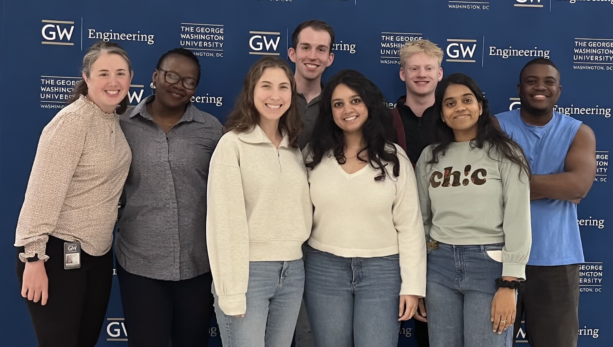
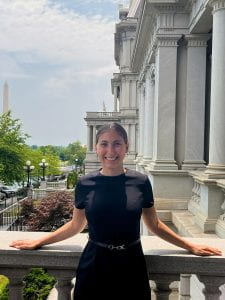
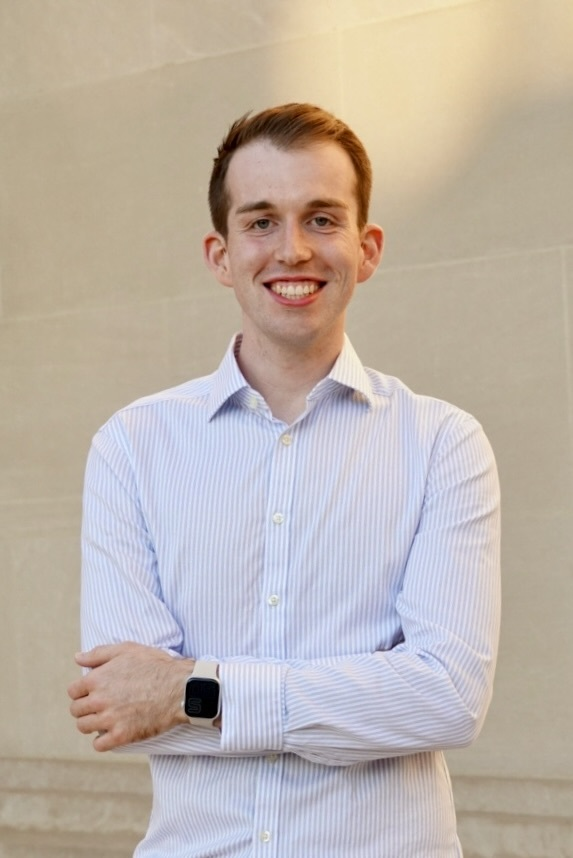
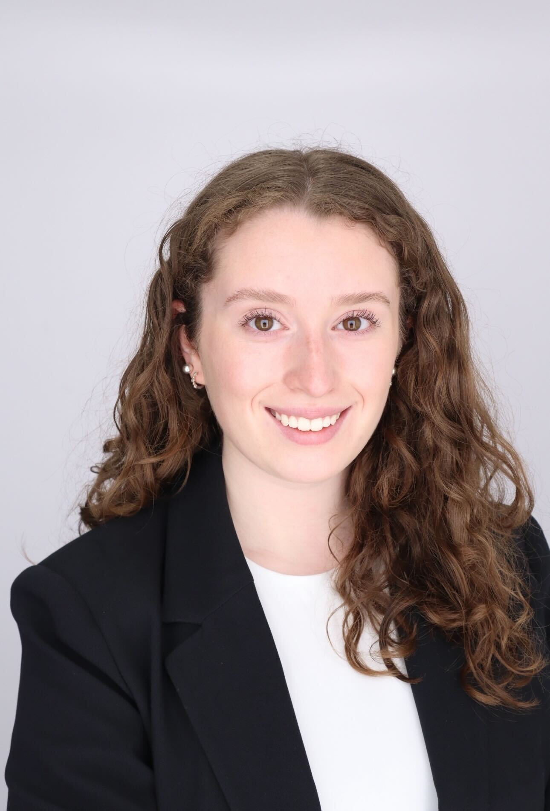
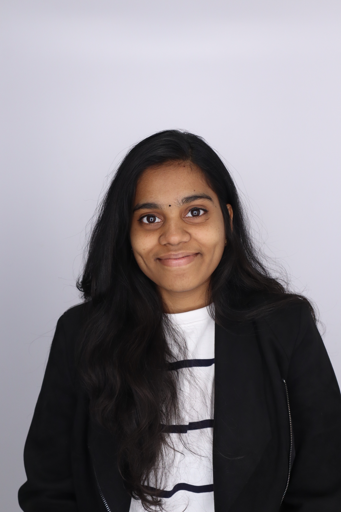
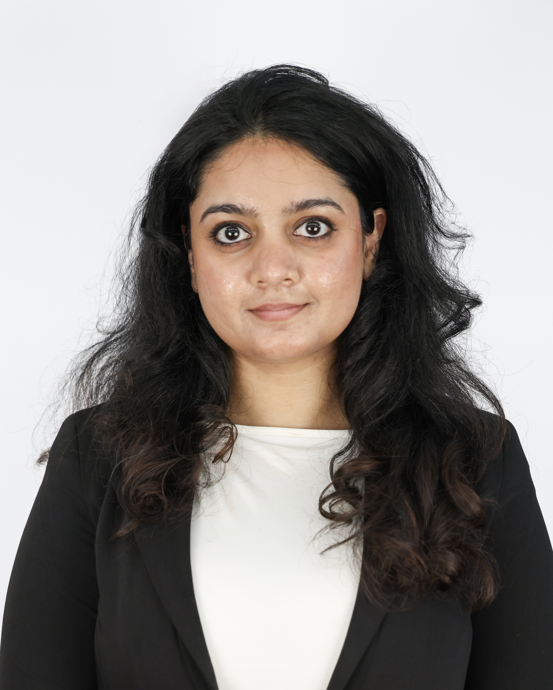
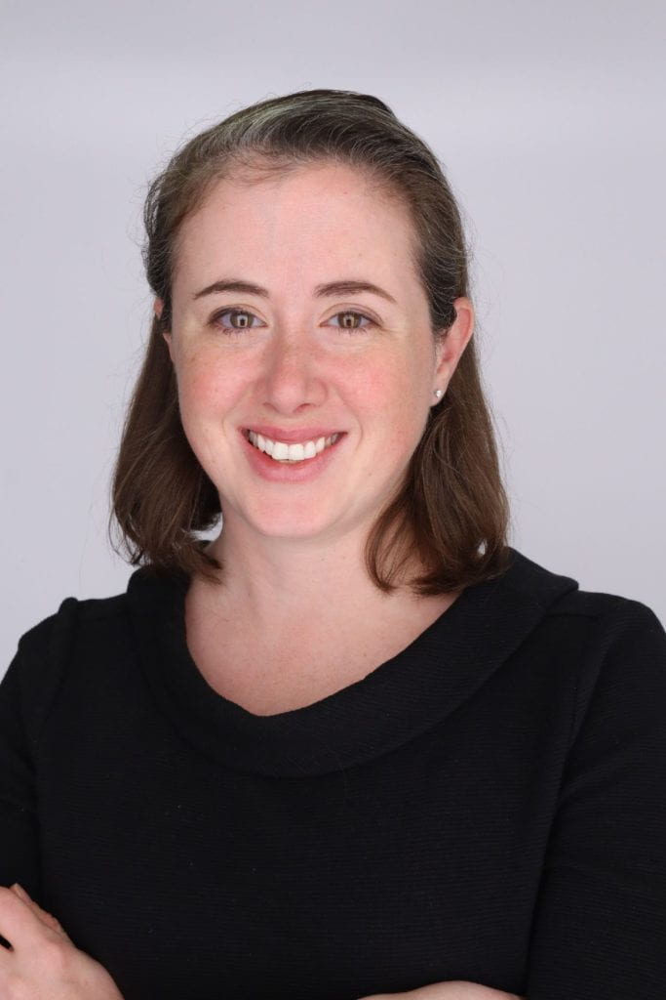

{fig-alt="The FEWsLab team" width="700px" fig-align="center"}

## PhD Students

:::float-left

### **Abbey Kollar**

Abbey is a doctoral student in the Systems Engineering Ph.D. program at GWU. She received her B.S. in Chemical Engineering with honors and a minor in Applied Economics from The Pennsylvania State University in 2023. Abbey’s undergraduate research focused on the conversion of plastics to oil and reducing nitrous oxide production from fertilizer use. Her experiences in the Washington Internships for Students of Engineering (WISE) program and study abroad in London sparked her international science policy interests. She is currently a NSF Graduate Research Fellow and a Co-Design of Trustworthy AI Systems (DTAIS) NRT Fellow. She also serves on the IEEE-USA AI Policy Committee and IEEE Planet Positive AI and Data Center Committee and was a contributing author for the ASCE 2026 Virginia Infrastructure Report Card Energy Chapter. Her research interests include resilient energy systems, data centers, and energy security. She hopes to use her technical expertise to inform policy.

 

### **Bryce Huffman**

Bryce is a doctoral student in the Systems Engineering Ph.D. program at GWU. He received his B.S. in Systems Engineering and Economics from the University of Virginia in 2022. His research interests are at the intersection of artificial intelligence and human systems, specifically focused on methods to embed advanced AI models into human workflows to support decision-making, efficiency, and efficacy. He is also interested in how human-AI interactions shape user trust and intuition development across expertise levels, as well as how these dynamics play out in real-world systems. In support of these interests, Bryce is a fellow in GW’s “Co-Design of Trustworthy AI Systems” (DTAIS) program.

 

:::

## Graduate Students

:::float-left

### **Madelyn McCarthy**

Madelyn is a graduate student studying Environmental and Sustainability Management at Georgetown University McDonough School of Business. Her research interests focus on the global green energy transition and on exploring how science, business, and policy can collaborate to create meaningful environmental change. Outside of the lab, Madelyn enjoys traveling, practicing Pilates, and discovering new matcha spots.

 

:::

:::float-left

 

### **Sai Lekhana**

Sai Lekhana is a master’s student in the Engineering Management program at George Washington University. She completed an Integrated Master of Science in Chemistry from the S V National Institute of Technology in 2024, and plans to build her career as a project or program manager. In summer 2026, Sai worked as a Volunteer Systems & Platform Intern at Engineers Without Borders USA, where she improved the organization’s Salesforce data quality, gathered staff input that shaped its first AI policy, and coordinated a digital platform migration across teams. She is skilled in R, SQL, and data visualization. She also serves as a President GW Net Impact, a student organization focused on sustainability and social impact. Outside the lab, she paints, with a particular love for stencil art portraits.

:::

 

## Lab Manager

:::float-left

### **Sachi Nandurkar**

Sachi is a Research Associate and Lab Manager at FEWsLab, she completed her master’s in the Engineering Management program at GWU (May 2025). Her research uses systems modeling, carbon mapping, and scenario analysis to study how industries decarbonize, with motorsport and sustainable fuels as a central focus. She also serves as the Lab Manager for the FEWsLab where she supports organization and project management for the team and PI Grady. Previously she served as a Graduate Teaching Assistant, where she taught labs on advanced Excel, SQL, and ERDs. She has experience in global program management and data analytics.

:::

 

## Principal Investigator

:::float-left

### **Dr. Caitlin Grady**
{float="left" width="150px" style="margin-right: 20px; margin-bottom: 50px;"} Dr. Caitlin Grady is an Associate Professor in the Department of [Engineering Management and Systems Engineering](https://emse.engineering.gwu.edu/) and the Director of Research at the [Global Food Institute](https://globalfoodinstitute.gwu.edu/).  Her academic background and research expertise spans a variety of engineering and policy domains across food, energy, and water systems. This includes both qualitative and quantitative approaches to studying systems such as agricultural trade, the electricity grid, natural hazards, and adaptation to climate change. Prior to her academic roles, she held several federal government roles including with the House of Representatives, the Department of Energy, and the Department of State. In these roles, she worked on a myriad of issues including agriculture, water & energy, air quality,  budget & appropriations, international development, and diplomatic engagement.

**Education:**  
Ph.D., Civil and Environmental Engineering, Purdue University  
M.S., Agricultural and Biological Engineering, Purdue University  
B.S., Science and Technology Studies, Virginia Tech (Humanities, Science, and the Environment Major; Environmental Policy and Planning Minor)

:::

 

## Alumni
- Dhanyasri Bolla (2024-2025): M.S. Engineering Management, George Washington University. Now PhD student at Arizona State University.
- Tarun Kumanduri (2024-2025): M.S. Data Analytics, George Washington University. 
- Jose Fernandez (2017–2018): M.Eng., Penn State Civil Engineering, Water Resources. Now Project Engineer in Ecuador.
- Andrew Pannone (2017–2018): Undergraduate, Penn State Engineering. Now PhD student in Dr. Saptarshi Das Lab, Penn State.
- Jack Iffert (2018–2019): B.S. Civil Engineering. Now Transportation Analyst at Kimley Horn.
- Jared Lawrence (2018–2019): MIA, PSU School of International Affairs.
- Maya Zambrano-Lee (Summer 2019): Visiting undergrad, Univ. of Maryland. Now Sustainability Intern, City of Brunswick.
- Abby Cowser (2019–2020): B.S. Civil Engineering. Now Staff Engineer, WDP & Associates.
- Tasnuva Mahjabin (2017–2020): Ph.D. Civil Engineering. Now Water Resources Engineer II at Atkins.
- Autumn Deitrick (2019–2021): B.S. Civil Engineering. Now Ph.D. student in Engineering Education at Penn State.
- Tori Lenze (2020–2022): B.S. Mechanical Engineering. Now graduate student at Penn State.
- Yuchen Fu (2021–2022): B.S. Civil Engineering. Now graduate student at Stanford University.
- Xinran Zhang (2021–2022): B.S. Civil Engineering. Now graduate student at University of Michigan.
- Luis Delgado (2020–2022): M.S. Civil Engineering. Now PhD student in Engineering Education at Penn State.
- Sarah Torhan (2020–2022): M.S. Civil Engineering. Now PhD student at Penn State.
- Lauren Dennis (2019–2023): Ph.D. Civil Engineering, Climate Science. Now Presidential Management Fellow.
- Paniz Mohammadpour (2018–2023): Ph.D. Civil Engineering. Now Water Resources Engineer II at Atkins.
- Selena Hinojos (2021-2025) : Ph.D. in Engineering Management. Now Post Doc at University of Lousiana.
- Rebecca Germaine (2023-2025) : B.S. in Public Health. Now a masters student at GW.
- Sachi Nandurkar (2023-2025) : M.S. in Engineering Management. Now the FEWsLab Lab manager! 

---

## Student Awards

- Bryce Huffman - NSF Graduate Research Fellowship Honorable Mention (2025)
- Abbey Kollar – NSF Graduate Research Fellowship (2024)  
- Lauren Dennis – Presidential Management Fellow (2023)  
- Sarah Torhan – NDSEG Fellow, Fulbright Fellow, Boren Fellow (2022)  
- Autumn Deitrick – NSF Fellow (2021), Goldwater Scholar (2020), Mission Award (2021)  
- Selena Hinojos – Bunton-Waller Fellowship (2020–2021)  
- Luis Delgado – GEM Fellow, Bunton-Waller Fellowship (2020–2021)  
- Abby Cowser – ASCE New Faces of Civil Engineering, Oswald Award (2020)  
- Lauren Dennis – PSU Graduate Fellowship (2019–2020), NSF NRT Fellow (2020–2021)  
- Paniz Mohammadpour – CUAHSI Travel Scholarship (2019)  
- Jack Iffert – Ralph Dorn Hetzel Award (2019), Engineering Technology and Ethics Fellowship (2018)  
- Tasnuva Mahjabin – Travel Grant (AGU Fall Conference), SESYNC Workshop Award (2018)  
- Andrew Pannone – CERI Scholarship (2018), REU Fellowship (2018)

---

*Current and prospective students are encouraged to contact Dr. Grady for opportunities.*

